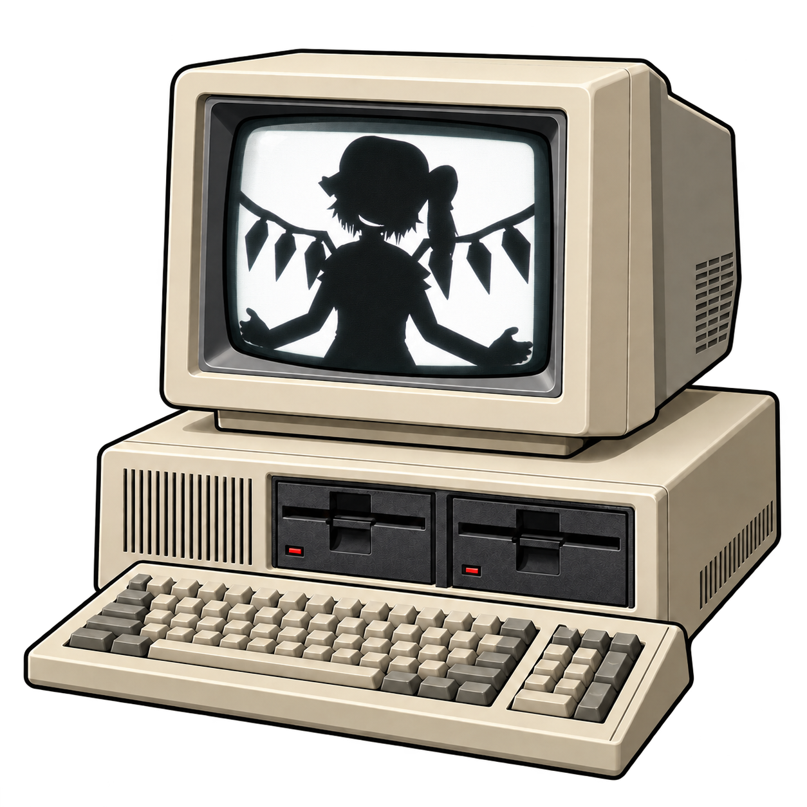

# XDC Studio



A portable Windows x64 video converter and preview player for **XDC on 8088 PCs running DOS**. Based on [Jim Leonard’s original XDC](https://github.com/MobyGamer/XDC), with a native C# encoder port and a Russian/English interface.

[Русское описание](docs/README.ru.md) · [Build instructions](BUILDING.txt) · [Changelog](CHANGELOG.md) · [Original README](docs/UPSTREAM-README.md)

## Features

- MP4, MKV, WebM and other FFmpeg inputs, converted directly to XDV.
- CGA Composite (160×200 / 160×100), monochrome CGA RGB (640×200), and Tandy (160×200).
- NTSC-aware colour matching for early and late CGA; **old mode** for flat-palette matching.
- Gamma, saturation, dither strength, Bayer 8×8 / 4×4 and static blue noise.
- Optional temporal stabilization using reconstructed VRAM and estimated 8088 update costs.
- Automatic source/result comparison, seeking, and XDV playback with sound and volume controls.
- Offline HTML help in Russian and English, available through Help or F1.
- RGB/PCM processing in bounded RAM: no DOSBox or intermediate BMP/WAV files. The finished XDV is written to disk.

The NTSC preview is a model, not a calibration of a particular CRT. Stabilization increases conversion time. Check the finished XDV on the target PC; real disk stalls and CGA snow are not simulated.

## Run

Extract the **entire** Windows x64 portable ZIP and open `XdcConverter.exe`. Keep `app/` and `docs/` beside it. No separate .NET installation is required. Select a video, target profile and output, then convert. Start with a short excerpt and use the built-in Help for settings.

Copy the resulting XDV, generated BAT and original `XDC_PLAY.EXE` to the DOS machine. For player hardware requirements, see the [original documentation](https://x86dc.wordpress.com/).

## Build on Windows x64

Use PowerShell 7 (`pwsh`) and Git. From the repository root:

```powershell
./fetch-dependencies.ps1
./build.ps1 -Package
./tests/run.ps1
./package-source.ps1
```

The dependency script downloads a pinned .NET SDK and FFmpeg build and verifies hashes. It does not install them system-wide. Python 3 is needed for the integration checks. Outputs go into `dist/`; source media, local results and caches are excluded from Git. See [BUILDING.txt](BUILDING.txt) for details.

The [Windows CI workflow](.github/workflows/windows.yml) builds, runs synthetic tests and uploads build artifacts. It does not publish a release. The workflow is prepared locally; a successful GitHub Actions run can only be confirmed after pushing to a fork.

## Repository layout

| Path | Contents |
| --- | --- |
| `XDC_*.PAS`, `compiled/`, `palette/`, `template.scr` | Original XDC sources and reference binaries, retained in their original locations |
| `src/` | Windows converter, encoder port, NTSC model and player |
| `assets/` | Application icon and its provenance |
| `docs/` | Offline help, implementation notes and reference measurements |
| `tests/` | Repeatable synthetic checks, independent XDV decoder and optional MIR comparisons |
| `local/` | Ignored user media, old source archives and retained comparison outputs |
| `dist/` | Ignored current portable/source distribution |

## Credits and licence

**Special thanks to Jim Leonard (Trixter / MobyGamer), author of XDC.** This project builds on his format, delta compiler and DOS player. The original player is bundled unchanged. This fork is independently maintained and is not an official upstream release.

- [Original XDC repository](https://github.com/MobyGamer/XDC)
- [XDC documentation](https://x86dc.wordpress.com/)
- [Original source preparation guide](https://x86dc.wordpress.com/documentation/xdc-compiler/preparing-source-material/)
- [Trixter’s blog](https://trixter.oldskool.org/)

Source code is distributed under the original [MIT licence](LICENSE). Bundled FFmpeg and .NET components retain their own licences; see [THIRD-PARTY.txt](THIRD-PARTY.txt) and [dependency source links](docs/DEPENDENCIES.md). Artwork provenance is documented in [assets/README.md](assets/README.md). MIR and other user-supplied videos are not distributed with this repository.

## Preparing a GitHub fork

The working repository preserves the upstream Git history. Creating the GitHub fork and pushing are separate steps requiring the repository owner’s account: [publishing instructions](docs/PUBLISHING.md).
